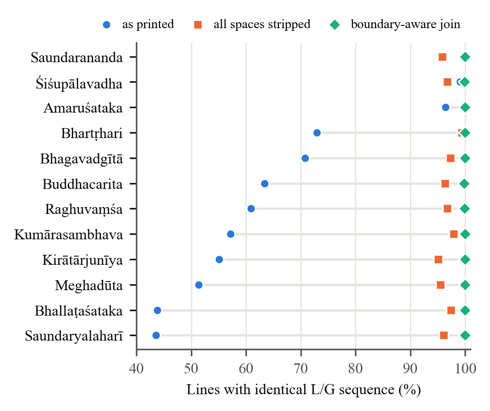

# Cross-Tool Reliability Audit of Sanskrit Meter Identifiers

This repository compares two open-source programs that identify Sanskrit meter, **chanda** and **skrutable**. We ran both over 7,714 verses taken from twelve classical works and used a third, separately written scanner (**vidyut-chandas**) to check the results.

The repository releases three things:
- **A 6,115-verse consensus dataset** of Sanskrit verse labelled with syllable weights and meter.
- **The full audit pipeline.**
- **Every intermediate result** behind the reported numbers.

[](https://creativecommons.org/licenses/by-nc-sa/4.0/)


---

## Contents

- [Why this project](#why-this-project)
- [Key findings](#key-findings)
- [The dataset](#the-dataset)
- [Repository layout](#repository-layout)
- [Results files](#results-files)
- [Reproducing the study](#reproducing-the-study)
- [Method in brief](#method-in-brief)
- [Limitations](#limitations)
- [Citation](#citation)
- [License](#license)
- [Acknowledgements](#acknowledgements)
- [Authors](#authors)

---

## Why this project

Every Sanskrit meter is a fixed sequence of light (*laghu*, L) and heavy (*guru*, G) syllables. Whether a syllable is light or heavy is settled by a handful of mechanical rules, which is why meter detection is normally left to rule-based programs.

Such programs are now relied on as a source of truth. They decide which verses go into training corpora, they score poems produced by language models, and they are used to spot mistakes in digitised texts. Their published evaluations, however, use only about a thousand verses each.

We set out to answer four questions:
1. On a large corpus, how often do two separately written identifiers give the same answer?
2. When their answers differ, what is the cause?
3. What has to happen before their output can serve as reliable labels?
4. Have these differences affected work that is already published?

## Key findings

| Finding | Evidence |
|---|---|
| Most line-level disagreement comes from how the input is prepared. | With the e-text fed in unchanged, only **74.3%** of lines get the same L/G pattern from both tools. Our boundary-aware word join (a consonant-final word is attached to the next word, while vowel hiatus stays split) brings this to **99.95%**. Each of the 8 lines still in dispute has malformed characters. |
| Once the input is fixed, whole verses mostly agree too. | 6,115 of the 7,714 verses (**79.3%**) get identical results from both tools. |
| Well-formed text produced no scansion errors. | There are 82 verses where the two scansions disagree, and we sorted all of them. In 75, every mismatch falls on the last syllable of a pāda or line; the remaining 7 contain malformed characters. |
| An independent third scanner agrees with the consensus. | Ignoring the last syllable of each line, vidyut-chandas matches the consensus L/G pattern on **99.95%** of lines. Of the 2,644 consensus verses in meters it knows, it assigns the same name to 94.25%. |
| The tools apply different prosodic conventions. | skrutable lets a light pāda-final syllable count as heavy in samavṛtta meters (831 verses pass this way), yet in ardhasama and viṣama meters it rejects all 217 such verses. chanda gives no meter name at all when a pāda ends light, and it has no rule for the anuṣṭubh *vipulā* variants. |
| Faults flagged by the tools are mostly typos in the e-texts. | Among sampled verses with a length or internal deviation, 23 of 24 have an error in the text. Every proposed correction was scanned again to confirm it. |
| Problems in the corpus itself. | Four GRETIL files carry 906 extra copies of verses with the sandhi undone. Errors we sampled in GRETIL also show up in Sanskrit Wikisource. |
| Effects on a published benchmark (Chandomitra, EACL 2026). | Only **0.05%** of verses in its chanda-filtered dataset use a *vipulā* form; in the Rāmāyaṇa the figure is **20.1%**. With skrutable 2.2.0 or later, a changed label format makes its released metric reject every human-written reference verse. |



## The dataset

`release/` contains the **two-tool consensus set**:
- 6,115 verses;
- 42 meters;
- 12 works.

A verse is included only when both of these hold:
- skrutable judges it a perfect fit for its meter;
- both tools give the identical L/G sequence and agree on the meter name.

> **Silver standard.** Nobody has checked these verses by hand; they are in the set because independent tools agree on them. A mistake made by both tools would still get through. The vidyut-chandas check makes that less likely but cannot exclude it.

| File | Format |
|---|---|
| `release/chandas_consensus.jsonl` | One JSON object per verse |
| `release/chandas_consensus.csv` | Flat table (lines joined with ` / `) |
| `release/README.md` | Data card: counts by text and meter, caveats, license |

**Fields**

| Field | Description |
|---|---|
| `id` | `<Text>:<GRETIL xml:id>`, e.g. `Meghaduta:KMgD_1` |
| `source_text` | Work |
| `gretil_file` | Source TEI file |
| `lines_iast` | Verse lines in IAST, as printed in GRETIL (editorial marks removed) |
| `lg_by_line` | L/G sequence per line |
| `lg_by_pada` | L/G sequence per pāda |
| `meter` | Meter name (IAST) |
| `meter_class` | `anustubh`, `samavrtta`, `upajati`, `ardhasama` or `vishama` |
| `skrutable_label` | Full skrutable label, including the gaṇa formula (JSONL only) |

**Example record**

```json
{
  "id": "Meghaduta:KMgD_1",
  "source_text": "Meghaduta",
  "lines_iast": ["kaś cit kāntāvirahaguruṇā svādhikārapramattaḥ śāpenāstaṅgamitamahimā varṣabhogyeṇa bhartuḥ", "..."],
  "lg_by_pada": ["GGGGLLLLLGGLGGLGG", "GGGGLLLLLGGLGGLGG", "GGGGLLLLLGGLGGLGG", "GGGGLLLLLGGLGGLGL"],
  "meter": "mandākrāntā",
  "meter_class": "samavrtta"
}
```

**Composition.** By meter class:

| Meter class | Verses |
|---|---|
| anuṣṭubh | 1,991 |
| upajāti | 1,246 |
| other samavṛtta | 2,422 |
| ardhasama | 309 |
| viṣama | 147 |

By work:

| Work | Verses |
|---|---|
| Raghuvaṃśa | 1,313 |
| Śiśupālavadha | 963 |
| Kirātārjunīya | 912 |
| Saundarananda | 906 |
| Kumārasambhava | 578 |
| Bhagavadgītā | 540 |
| Buddhacarita | 413 |
| Bhartṛhari | 208 |
| Meghadūta | 111 |
| Saundaryalaharī | 92 |
| Bhallaṭaśataka | 68 |
| Amaruśataka | 11 |

## Repository layout

```
.
├── release/            Consensus dataset (JSONL, CSV) and its data card
├── results/            Every report, table and per-verse classification behind the findings
│   └── chandomitra/    Downstream case study (Chandomitra benchmark)
├── figures/            Figures (PNG and PDF)
├── src/                Pipeline scripts
├── requirements.txt    Pinned dependencies
└── README.md
```

Not tracked (see `.gitignore`):
- `data/raw/`: third-party sources, downloaded by the setup steps below.
- `data/interim/`: regenerated by the pipeline.

### Scripts (`src/`)

| Script | Purpose |
|---|---|
| `extract_gretil.py` | Extracts clean IAST verses from the GRETIL TEI files and drops sandhi-dissolved duplicate copies |
| `prosody_text.py` | **Boundary-aware word join**: resyllabifies consonant-final words and keeps vowel hiatus apart |
| `label_meters.py` | Runs chanda (per line) and skrutable (per verse), and marks consensus membership |
| `audit_tools.py` | Line-level comparison under three chanda input modes (as printed, spaces stripped, boundary-aware) |
| `audit_report.py` | Corpus, line- and verse-level tables with Wilson 95% intervals (`results/audit_report.md`) |
| `classify_faults.py` | Classifies skrutable-flagged verses: length, internal or pāda-final deviation, anuṣṭubh fault tags |
| `census_cd.py` | Deterministic census of **every** verse with differing scansions (C) or differing names (D) |
| `vidyut_check.py` | Third-scanner check with vidyut-chandas on all 16,205 lines |
| `make_adjudication_sample.py` | Draws the stratified 66-verse adjudication sample (seed 21) |
| `fill_proposals.py` | Writes first-pass causes into the sample sheet |
| `verify_corrections.py` | Applies each proposed text correction and re-runs both tools (metrical-restoration test) |
| `finalize_adjudication.py` | Produces the verified sheet and the cause-by-stratum table |
| `make_blind_sheet.py` | Creates the blind Excel sheet for an independent second coder |
| `compute_kappa.py` | Cohen's κ with bootstrap CI and confusion matrix, once the second coder has finished |
| `chandomitra_case.py` | Case study: anuṣṭubh half-verse forms in the Chandomitra dataset vs. the Rāmāyaṇa |
| `skrutable_version_probe.py` | Runs Chandomitra's released metric under any skrutable version |
| `export_gold.py` | Exports the consensus set to `release/` |
| `make_figures.py` | Renders the figures in `figures/` |

## Results files

| File | Contents |
|---|---|
| `results/audit_report.md` | Corpus table, line-level agreement by input mode and text, verse-level outcomes |
| `results/fault_classes.jsonl` | Fault class for each of the 1,271 skrutable-flagged verses |
| `results/census_cd.md`, `census_cd.jsonl` | Census of all outcome-C (82) and outcome-D (246) verses |
| `results/vidyut_check.md` | Third-scanner agreement by outcome group, meter-name agreement |
| `results/adjudication_codebook.md` | Codes (TXT, ENC, CHN, SKR, PAD, DB, LIC, UNK) and weight rules |
| `results/adjudication_sample.csv` | The 66 sampled verses with tool outputs and first-pass causes |
| `results/adjudication_verified.csv` | Final cause, evidence codes, confidence and corrected reading per verse |
| `results/adjudication_table.md` | Causes by stratum |
| `results/correction_check.tsv` | Tool output after each proposed correction |
| `results/witness_check.md` | Readings checked against independent e-texts, and errors propagated to Wikisource |
| `results/coder2_sheet.xlsx`, `CODER2_INSTRUCTIONS.md` | Blind second-coder sheet and instructions |
| `results/chandomitra/forms_summary.md` | Half-verse form distribution: Chandomitra dataset vs. Rāmāyaṇa |
| `results/chandomitra/metric_by_version.jsonl` | Chandomitra's metric on reference verses under skrutable 2.0.7 and 2.10.0 |
| `results/chandomitra/metric_current_fixed.jsonl` | The same metric with the separator patched |

## Reproducing the study

### 1. Environment

```bash
python -m venv .venv
source .venv/bin/activate          # Windows: .venv\Scripts\activate
pip install -r requirements.txt
```

All reported numbers were produced with Python 3.10 and the pinned versions:
- chanda 1.1.0;
- skrutable 2.10.0;
- vidyut 0.4.0.

On Windows, run scripts with `python -X utf8 ...` so that IAST prints correctly in the console.

### 2. Source data

```bash
# GRETIL TEI editions (CC BY-NC-SA 4.0)
mkdir -p data/raw/gretil
for f in sa_kAlidAsa-meghadUta sa_bhAravi-kirAtArjunIya sa_mAgha-zizupAlavadha \
         sa_kAlidAsa-raghuvaMza sa_kAlidAsa-kumArasaMbhava sa_amaru-amaruzataka \
         sa_bhatRhari-zatakatraya sa_zaMkara-saundaryalaharI sa_azvaghoSa-buddhacarita \
         sa_azvaghoSa-saundarAnanda sa_bhallaTa-bhallaTazataka sa_bhagavadgItA-comm \
         sa_rAmAyaNa; do
  curl -L -o "data/raw/gretil/$f.xml" "https://gretil.sub.uni-goettingen.de/gretil/corpustei/$f.xml"
done

# Meter data for vidyut-chandas
python -c "import vidyut; vidyut.download_data('data/raw/vidyut')"

# Chandomitra dataset (case study only)
mkdir -p data/raw/chandomitra
for s in train test; do
  curl -L -o "data/raw/chandomitra/$s.parquet" \
    "https://huggingface.co/datasets/sanganaka/anushtup/resolve/main/data/$s-00000-of-00001.parquet"
done

# Older skrutable release for the version study (case study only)
pip install --no-deps --target data/raw/skrutable/2.0.7 skrutable==2.0.7
```

The Rāmāyaṇa file is used only by the case study; the corpus extractor reads the twelve named works.

### 3. Audit pipeline

```bash
python src/extract_gretil.py data/raw/gretil data/interim/verses_raw_v2.jsonl
python src/label_meters.py   data/interim/verses_raw_v2.jsonl data/interim/verses_labeled_v2.jsonl
python src/audit_tools.py    data/interim/verses_raw_v2.jsonl data/interim/audit_lines.jsonl
python src/audit_report.py                       # -> results/audit_report.md
python src/classify_faults.py data/interim/verses_labeled_v2.jsonl results/fault_classes.jsonl
python src/census_cd.py                          # -> results/census_cd.md
python src/vidyut_check.py                       # -> results/vidyut_check.md
python src/export_gold.py                        # -> release/
python src/make_figures.py --out figures
```

### 4. Adjudication

```bash
python src/make_adjudication_sample.py           # 66-verse stratified sample (seed 21)
python src/fill_proposals.py results/adjudication_sample.csv
python src/verify_corrections.py > results/correction_check.tsv
python src/finalize_adjudication.py              # -> results/adjudication_verified.csv
python src/make_blind_sheet.py                   # -> results/coder2_sheet.xlsx
python src/compute_kappa.py results/coder2_sheet.xlsx   # after the second coder has finished
```

`make_adjudication_sample.py` rewrites the sample sheet. Run `fill_proposals.py` again afterwards.

### 5. Downstream case study

```bash
python src/chandomitra_case.py --workers 6       # -> results/chandomitra/forms_summary.md
python src/skrutable_version_probe.py data/raw/skrutable/2.0.7 test
python src/skrutable_version_probe.py installed test
```

## Method in brief

1. **Line level.** Both tools scan every line. Because chanda reads each space as the end of a syllable, it gets the input in three forms:
   - **(a)** unchanged;
   - **(b)** with every space deleted;
   - **(c)** after the boundary-aware join, which glues neighbouring words together but leaves the space in place when a vowel-final word is followed by a vowel-initial one. Two prosodic rules follow from this:
     - *tad evam* → *ta-de-vam*;
     - *vyatikara iva* → *ra-i-va*, not the diphthong *rai*.
2. **Verse level.** skrutable takes the verse as a whole, names its meter and says whether it fits exactly; chanda suggests meters line by line. Every verse is then given one outcome:
   - **A.** The tools agree completely; these verses form the consensus set.
   - **B.** The L/G patterns match, but skrutable reports a fault.
   - **C.** The L/G patterns are different.
   - **D.** The tools give different meter names.
3. **Census.** Every C and D verse is sorted by fixed rules into one of these groups: difference only at a boundary, malformed characters, vipulā, pāda-final, coverage, or naming.
4. **Third scanner.** Every line is scanned again with vidyut-chandas, which was written independently of the other two tools.
5. **Adjudication.** A stratified sample of 66 verses that did not make the consensus set is coded using the codebook. Any proposed text correction is applied and scanned again, and readings are compared with independent e-texts when one can be found.
6. **Case study.** We look at how the same tools behave inside Chandomitra's released dataset and evaluation code.

## Limitations

- **Only two main tools.** The comparison covers two primary identifiers, and the consensus set contains very few mātrā meters.
- **One round of coding for outcome B.** The cause percentages given for outcome B are based on a stratified sample that was coded only once. No second coder has been through it yet, so inter-annotator agreement is still to be measured.
- **Corrections not attested.** Nine corrections restore the meter but have not been checked against a printed edition.
- **Rates depend on the corpus.** Editorial practice is not uniform across the GRETIL files, so the percentages describe this corpus. The types of failure we found, and the convention differences, are expected to apply more widely.
- **Limits of the case study.** Chandomitra's data is based on a different edition of the Rāmāyaṇa from the GRETIL one. Its model outputs were never released, so only the reference verses could be used to test the metric.

## Citation

If you use the dataset or code, please cite:

```bibtex
@misc{srivastava2026meteraudit,
  title  = {A Cross-Tool Reliability Audit of Sanskrit Meter Identifiers:
            Input Handling, Prosodic Conventions, and Downstream Reproducibility},
  author = {Srivastava, Atharva and K, Aditya and Potharaju, Abhinav and S K, Nischitha},
  year   = {2026},
  note   = {Dataset and code. RV College of Engineering, Bengaluru}
}
```

Please also cite GRETIL and the tools:
- chanda / Chandojñānam (Terdalkar & Bhattacharya, 2023);
- skrutable (Neill);
- vidyut (Ambuda).

## License

- **Dataset** (`release/`): [CC BY-NC-SA 4.0](https://creativecommons.org/licenses/by-nc-sa/4.0/). The verse texts derive from GRETIL e-texts distributed under the same license, so the dataset inherits it: attribution, non-commercial use, and share-alike.
- **Code** (`src/`): see `LICENSE`.

## Acknowledgements

- **Source texts:** the GRETIL project (SUB Göttingen) and its contributors, for the TEI editions of the source texts.
- **Tools:**
  - Hrishikesh Terdalkar and Arnab Bhattacharya, for *chanda*;
  - Tyler Neill, for *skrutable*;
  - the Ambuda project, for *vidyut*.
- **Chandomitra:** the Chandomitra authors, for releasing their dataset and evaluation code.

## Authors

| Name | Affiliation | Contact |
|---|---|---|
| Atharva Srivastava | Department of AIML, RV College of Engineering, Bengaluru | atharvas.ai23@rvce.edu.in |
| Aditya K | Department of AIML, RV College of Engineering, Bengaluru | adityak.ai23@rvce.edu.in |
| Abhinav Potharaju | Department of AIML, RV College of Engineering, Bengaluru | abhinavsrinivas.ai23@rvce.edu.in |
| Nischitha S K | Department of CSE, RV College of Engineering, Bengaluru | nischithask@rvce.edu.in |
